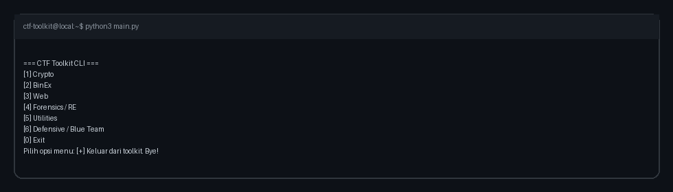
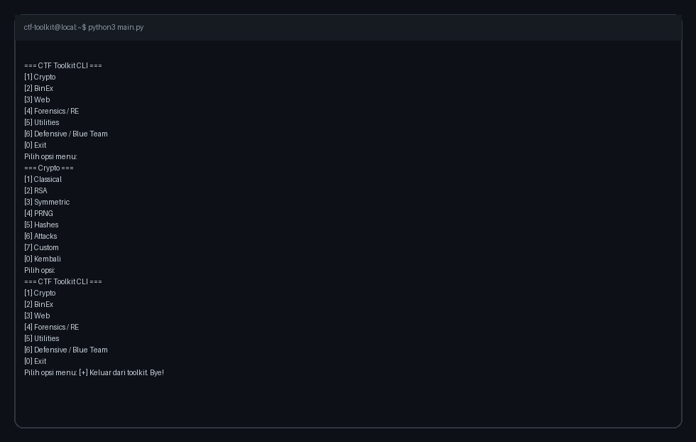
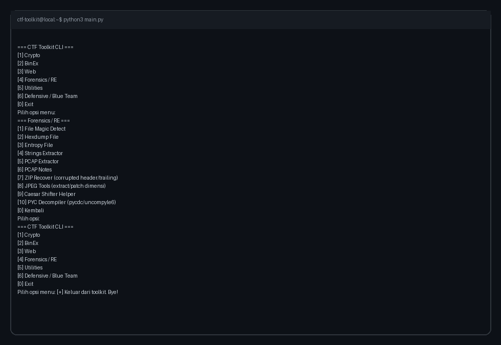

# CTF Toolkit v3.0 Apex

> **Multi-Domain CTF Exploitation Workbench, Autonomous A\* Magic Solver, CyberChef Pipeline Studio, and 106+ Solver Abstractions.**  
> Engineered for fast iteration across **Windows (PowerShell/CMD)**, **Linux (Kali/Ubuntu/WSL2)**, **macOS**, **Docker**, and **Single-File `.pyz` Jumpboxes**.


---

```text
╭──────────────────────────────────────────────────────────────────────────────╮
│ ⚡ APEX CTF WORKBENCH │ Main Hub          Case: default_case │ Vault: 0 Flags │
│ Buffer $last: <empty>   [/] Search  [:m] Magic  [:s] Studio  [:f] Flags  [0] │
╰──────────────────────────────────────────────────────────────────────────────╯
```

## Table of Contents
- [Overview & What's New in v3.0](#overview--whats-new-in-v30)
- [9-Domain Feature Matrix](#9-domain-feature-matrix)
- [Cross-Platform Quickstart](#cross-platform-quickstart)
- [Headless CLI & Piping Modes](#headless-cli--piping-modes)
- [TUI v3 Apex Hotkeys & Smart Input](#tui-v3-apex-hotkeys--smart-input)
- [Python Scripting API Usage](#python-scripting-api-usage)
- [Documentation Hub (`docs/`)](#documentation-hub-docs)
- [CLI Preview (Real Output)](#cli-preview-real-output)
- [Project Layout](#project-layout)
- [Validation & Test Suite](#validation--test-suite)
- [Safety & Legal Notice](#safety--legal-notice)
- [License](#license)

---

## Overview & What's New in v3.0

**CTF Toolkit v3.0 Apex** transforms the classic menu-based helper into a full-featured **CTF Command Center** that works both as an interactive Terminal UI (TUI) and a scriptable headless library:

1. **Autonomous "Magic" Solver (`:m` / `ctf-toolkit magic`):** Uses an **A\* Heuristic Search Tree** (inspired by *Ciphey*) to automatically crack multi-layered encodings and classical ciphers (up to 4 hops deep) and renders the winning path as a visual tree.
2. **Global Command Palette (`/search`):** Type `/wiener`, `/rop`, `/sqli`, `/docx`, or `/whois` from any menu to fuzzy-search across **106+ solver primitives** and execute them via an auto-generated parameter prompt.
3. **Interactive CyberChef Recipe Studio (`:s` / `ctf-toolkit recipe`):** Chain 35+ transformations (`b64d | xor:0x5a | zlib_d | flag_scan`) with a live **Step-by-Step Intermediate Trace Table**.
4. **ImHex-Style Binary Anatomy & Entropy Heatmap Inspector:** Automatically dissects **PNG chunks (+ trailing bytes after `IEND`)**, **ZIP/DOCX/XLSX archives**, **PDF streams**, and **ELF headers** alongside a colorized canonical hexdump and block entropy sparkline (`▁▂▃▄▅▆▇█`).
5. **Stateful Session Registers (`$last`, `$1..$n`) & 1-Click Writeup Exporter (`:export`):** Pipe outputs seamlessly between tools using `$last` and export your entire session into a standalone `solve_<case>.py` script + `WRITEUP_<case>.md` report.

---

## 9-Domain Feature Matrix

| Key | Domain Module | Highlights & Capabilities |
| :---: | :--- | :--- |
| **`1`** | **Crypto** | 30+ classical ciphers (Caesar, Vigenère, Beaufort, Autokey, Playfair, Bifid, Trifid, Hill 2x2/3x3, Rail Fence, Columnar, Myszkowski, ADFGVX, Bacon, Polybius), RSA attacks (Fermat, Wiener, Håstad CRT, Common Modulus, Pollard $p-1$, $d_p$ leak, Rabin), AES/DES/RC4/Fernet, LCG & Shamir Secret Sharing. |
| **`2`** | **BinEx / Pwn** | De Bruijn `cyclic` generator & offset finder, Visual Stack Frame diagram (`MOVAPS` 16-byte alignment check), `ret2win` & `ROP` chain crafters, Format String `%k$p` stack leak crawler, OOB array index math, ELF triage & `pwntools` boilerplate generator. |
| **`3`** | **Web** | **Payload Diff Matrix** (Burp Repeater/Intruder style status/size/latency comparison), SQLi auth bypass & UNION crafter, SSTI, Cloud SSRF metadata prober, LFI traversal generator, JWT unverified decoder, CORS/X-Forwarded-For bypass & IDOR matrix. |
| **`4`** | **Forensics / RE** | OOXML metadata/hidden text extractor (`DOCX`/`XLSX`), PDF stream decompressor, PNG trailing bytes & chunk repair, LSB image & WAV audio stego, DTMF/FSK audio decoder, PCAP DNS/HTTP/USB extractor, Git loose object string carver, `.pyc` bytecode extractor & binary XOR/shift transforms. |
| **`5`** | **Blockchain / EVM** | Ethereum ABI calldata parser, `uint256` charcode array decoder, EVM `Error(string)` & `Panic(uint256)` revert decoder, Keccak mapping/dynamic array storage slot calculator, and event receipt log parser. |
| **`6`** | **OSINT & Misc** | Certificate Transparency (`crt.sh`) parser, ASN/domain WHOIS parser, HTML archive comment extractor, coordinate/plaque landmark matcher, SQLite & Crontab secret hunter, JSON/YAML/INI/CSV/VCF/ICS config scanner, and Esolang interpreters (Brainfuck, Ook!, Deadfish, Spoon, Whitespace, Piet). |
| **`7`** | **Utilities** | Multi-radix encodings (Base32/36/45/58/62/64/85/91, Z85, Braille, Baudot, EBCDIC, UUDecode, XXDecode), XOR brute-forcer, regex flag scanner, and HTTP request tester. |
| **`8`** | **Defensive / Blue Team** | Multi-log fragment correlation, Suricata alert reassembly, EDR beacon sequence analyzer, HTTP Basic Auth & MIME log hunter, and Linux/Windows forensic artifact discovery. |
| **`9`** | **Workbench & Pipelines** | Auto-Triage & heuristic fingerprinter, Interactive CyberChef Recipe Studio, Autonomous A\* Magic Solver, and 1-Click Python Solver + Markdown Writeup exporter. |

---

## Cross-Platform Quickstart

### 1. Windows (PowerShell & Command Prompt)
Native launchers (`ctf.ps1` and `ctf.bat`) automatically enable UTF-8 console output (`chcp 65001` / `PYTHONIOENCODING=utf-8`):

```powershell
# PowerShell
python -m venv .venv
.\.venv\Scripts\Activate.ps1
pip install -r requirements.txt

# Launch TUI v3 Apex Command Center
.\ctf.ps1
```

```cmd
:: Windows Command Prompt (CMD)
ctf.bat
```

### 2. Linux (Kali / Parrot / Ubuntu / WSL2) & macOS
```bash
python3 -m venv .venv
source .venv/bin/activate
pip install -r requirements.txt

chmod +x ctf.sh
./ctf.sh
```

### 3. Global CLI Installation (`pipx` / `uv` / `pip`)
Install globally to invoke `ctf-toolkit` or its short alias `ctft` from any folder:
```bash
pipx install .
# or: uv tool install .
# or: pip install -e .

ctft --version
ctft
```

### 4. Portable Single-File `.pyz` Bundle (For Air-Gapped VMs & SSH Jumpboxes)
Build a single self-contained executable (`dist/ctf-toolkit.pyz`) that runs on any machine with Python 3.10+ without installing packages:
```bash
python scripts/build_portable.py
python dist/ctf-toolkit.pyz --version
python dist/ctf-toolkit.pyz
```

### 5. Docker Container
```bash
docker build -t ctf-toolkit:v3 .
docker run -it --rm -v "$(pwd):/work" ctf-toolkit:v3
```

---

## Headless CLI & Piping Modes

Run triage, chained recipes, or the autonomous A\* Magic Solver directly from your shell without entering the interactive menu:

```bash
# 1. Auto-Triage a file or string (with optional --json output)
python main.py triage challenge.bin
python main.py triage -s "RkxBR3toZWFkbGVzc190cmlhZ2V9" --json

# 2. CyberChef-style Recipe Pipeline
python main.py recipe "b64d | xor:0x33 | flag_scan" -d "cVoxcVFFWlxXWlx="

# 3. Autonomous A* Magic Solver (cracks multi-hop encodings automatically)
python main.py magic -s "RkxBR3t0ZXN0X21hZ2ljX3NvbHZlcn0="
python main.py magic @mystery_payload.enc --depth 4
```

---

## TUI v3 Apex Hotkeys & Smart Input

At **any menu prompt** in interactive mode, you can use these global commands and input tokens:

| Token / Hotkey | Action |
| :--- | :--- |
| `/<query>` | Search & run any of the **106+ solver functions** (e.g., `/fermat`, `/rop`, `/docx`, `/sqlite`). |
| `:m` / `:s` | Open **Autonomous Magic Solver** (`:m`) or **Interactive Recipe Studio** (`:s`). |
| `:f` / `:b` | View **Captured Flag Vault** (`:f`) or **Session Register History** (`:b`). |
| `:c` | Copy current `$last` register output to the OS clipboard. |
| `:case <name>` | Set active challenge case name (e.g., `:case web_sqli_01`). |
| `:export` | Export `solve_<case>.py` and `WRITEUP_<case>.md`. |
| `$last`, `$1`, `$2` | Pass previous tool output directly into the current prompt. |
| `@path/to/file` | Load raw bytes or text from a file into any prompt. |
| `hex:...` / `b64:...` | Inline decode hex or Base64 input at any prompt. |

---

## Python Scripting API Usage

Import `ctf_toolkit` directly inside your custom exploit or solver scripts:

```python
from ctf_toolkit.crypto.rsa import rsa_wiener, rsa_fermat
from ctf_toolkit.pwn import build_ret2win_payload, build_rop_chain, calculate_oob_offset
from ctf_toolkit.forensics.office import extract_docx_metadata
from ctf_toolkit.pipeline import run_recipe
from ctf_toolkit.ui.magic_solver import solve_magic

# 1. Chain encodings in one line
out = run_recipe("b64d | xor:0x42 | zlib_d", raw_payload)

# 2. Build 64-bit ret2win overflow payload
payload = build_ret2win_payload(padding_len=72, win_addr=0x401186, arch="x64")

# 3. Run autonomous A* multi-hop solver programmatically
best_bytes, path, score, _ = solve_magic(ciphertext_bytes, max_depth=4)
```

---

## Documentation Hub (`docs/`)

- **[TUI v3 & Headless CLI Guide](docs/TUI_AND_CLI_GUIDE.md):** Full reference for hotkeys, Smart Input prefixes, Recipe Studio commands, and `RECIPE_REGISTRY` tokens.
- **[Solver Abstractions Catalog (106+ Functions)](docs/SOLVER_CATALOG.md):** Complete API table across Crypto, Pwn, Web, Forensics, Reversing, Blockchain, and OSINT/Misc.
- **[Cross-Platform Installation & `.pyz` Deployment](docs/PLATFORM_INSTALL.md):** Detailed instructions for Windows PowerShell/CMD, Linux/Kali, macOS, Docker, and air-gapped `.pyz` bundles.
- **[Architecture & Extension Guide](docs/ARCHITECTURE.md):** Internal design of the engine/UI separation, A\* Magic Solver scoring, and how to add new primitives.
- **AI Assistant Guides:** [`copilot.md`](copilot.md) and [`claude.md`](claude.md).

---

## CLI Preview (Real Output)

> Real toolkit screenshots stored locally in `docs/assets/`:

### Main Menu


### Crypto Menu


### Forensics / RE Menu


---

## Project Layout

```text
ctf_toolkit/
  __init__.py
  __main__.py
  main_cli.py          # Entrypoint, CLI subcommands (triage/recipe/magic) & UTF-8 setup
  registry.py          # 9-Domain lazy-loaded menu registry
  triage/              # Heuristic fingerprinter, magic bytes & entropy analyzer
  pipeline/            # CyberChef-style RECIPE_REGISTRY & chained executor
  crypto/              # Classical (30+ ciphers), RSA attacks, AES/DES/RC4/Fernet, encodings
  pwn/ & binex/        # ROP, ret2win, format string, OOB array, cyclic, ELF triage
  web/                 # SQLi, SSTI, SSRF, LFI, JWT, IDOR, multipart & request helpers
  forensics/           # Office (DOCX/XLSX), PDF, PNG/GIF/JPEG, WAV/DTMF/FSK, PCAP, PYC
  reversing/           # Binary XOR/shift transforms & charcode decoders
  blockchain/          # EVM calldata, revert reason, storage slots & event logs
  osint_misc/          # CT/WHOIS/HTML parsers, SQLite/Cron/Config hunters & Esolangs
  defensive/           # Log correlation, Suricata reassembly & artifact discovery
  ui/                  # TUI v3 Apex (console, inspector, session, palette, magic_solver, menus)
scripts/
  build_portable.py    # Single-file dist/ctf-toolkit.pyz bundler
docs/                  # Technical guides & CLI screenshot assets
tests/                 # 118+ unit & synthetic twin benchmark test files (1,230+ tests)
ctf.ps1 / ctf.bat      # Windows PowerShell & CMD launchers
ctf.sh                 # Linux / macOS POSIX launcher
Dockerfile             # Containerized execution environment
run_tests.py           # Zero-dependency cross-platform test runner
```

---

## Validation & Test Suite

Run the complete test suite (**1,230+ unit & synthetic twin tests**) on Windows, Linux, or macOS:

```bash
# Cross-platform test runner (works on Windows PowerShell, CMD, Linux, and macOS)
python run_tests.py

# Build and verify portable .pyz bundle
python scripts/build_portable.py
python dist/ctf-toolkit.pyz --version
```

---

## Safety & Legal Notice

> ⚠️ **Authorized CTF, Lab & Educational Use Only**
>
> - Use this toolkit strictly on CTF challenges, authorized security labs, or systems you own/have explicit permission to test.
> - Offline file, binary, and PCAP analyses execute locally; JWT inspection helpers decode headers/claims without verifying cryptographic signatures.

---

## License
See [LICENSE](LICENSE).
