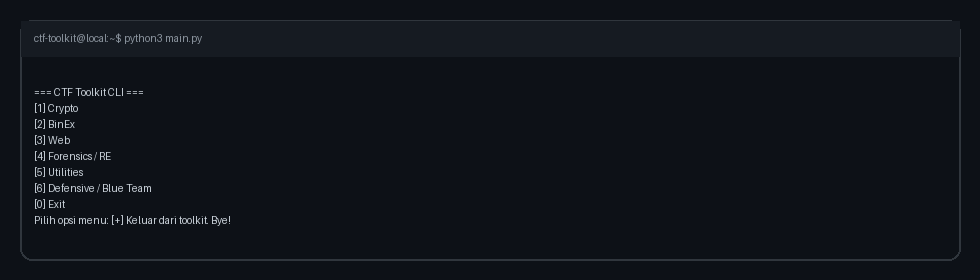
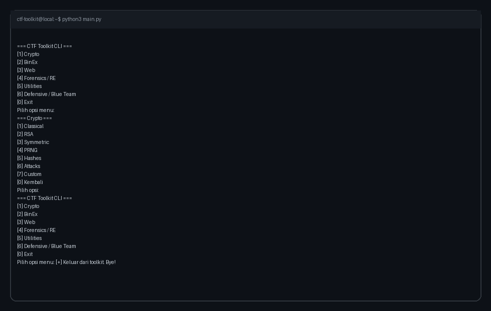
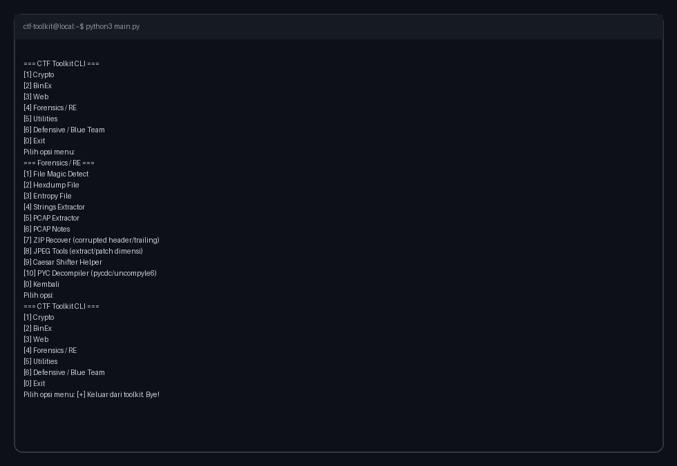

# CTF Toolkit v5

> **Multi-Domain CTF Exploitation Workbench, Autonomous A\* Magic Solver, CyberChef Pipeline Studio, and 560+ Callable Solver Functions.**  
> Engineered for rapid exploitation and analysis across **Windows (PowerShell/CMD)**, **Linux (Kali/Ubuntu/WSL2)**, **macOS**, **Docker**, and **Single-File `.pyz` Jumpboxes**.


---

```text
╭──────────────────────────────────────────────────────────────────────────────╮
│ ⚡ APEX CTF WORKBENCH v5.0 │ Main Hub      Case: default_case │ Vault: 0 Flags │
│ Buffer $last: <empty>   [/] Search  [:m] Magic  [:s] Studio  [:f] Flags  [0] │
╰──────────────────────────────────────────────────────────────────────────────╯
```

## Evidence Workbench

Version 5 adds persistent artifact cases, reproducible recipes, byte-level provenance, and a timeline for offline captures and logs. Use the local Workbench from the CLI or open one private team host for browser collaboration. Verified BagIt handoffs support reviews on another laptop.

    python -m ctf_toolkit case --dir exhibit-demo demo layered
    python -m ctf_toolkit case --dir exhibit-demo serve

Open the printed loopback URL, run triage on exhibit.png, and trace the output of Base64 decoding back to the source bytes.

[Workbench guide and private host setup](docs/CASE_WORKBENCH.md)

## Table of Contents
- [Overview & What's New in v5.0](#overview--whats-new-in-v50)
- [9-Domain Feature Matrix](#9-domain-feature-matrix)
- [Cross-Platform Quickstart](#cross-platform-quickstart)
- [Headless CLI & Universal Dispatcher](#headless-cli--universal-dispatcher)
- [TUI Hotkeys & Smart Input](#tui-hotkeys--smart-input)
- [Python Scripting API Usage](#python-scripting-api-usage)
- [Documentation Hub (`docs/`)](#documentation-hub-docs)
- [CLI Preview (Real Output)](#cli-preview-real-output)
- [Project Layout](#project-layout)
- [Validation & Test Suite](#validation--test-suite)
- [License](#license)

---

## Overview & What's New in v5.0

**CTF Toolkit v5.0** combines the **Evidence Workbench & Private Team Collaboration Host** with the **560+ function CTF Command Center**, operating as an interactive Terminal UI (TUI), a browser-based Evidence Workbench, and a scriptable headless library:

1. **v5 Evidence Workbench, Provenance & Private Team Host (`ctf_toolkit.cases`, `ctf_toolkit_team`):**
   - **Persistent SQLite Case Workspaces (`ctf-toolkit case`):** Store original artifacts, derived branches, deterministic recipe replays, byte-level provenance maps (`source`), side-by-side artifact comparisons (`compare`), and Timesketch-compatible timelines (`pcap`, `access`, `jsonl`).
   - **Offline BagIt Exchange & Private Team Host (`ctf-toolkit team`):** Pack/unpack/merge verified BagIt bundles across laptops or run an optional HTTPS Django + Uvicorn private team collaboration host with invite roles and note conflict resolution.
2. **Dynamic 560+ Function Command Palette (`/search`) & Universal CLI Dispatcher (`ctf-toolkit call`):** Dynamically indexes every public solver across all domain packages (`crypto`, `pwn`, `binex`, `web`, `forensics`, `reversing`, `blockchain`, `osint_misc`, `defensive`, `utils`, `triage`, `pipeline`). Search and run any function interactively with `/<query>` or headlessly via `ctf-toolkit call <func> [args...] [--json]`.
3. **Automated RSA, Lattice (LLL), Elliptic Curve, Paillier & Static AST Cascade (`crypto/`):**
   - **Auto-RSA & Signature Attacks (`solve_rsa_auto`, `bleichenbacher_forge_signature`):** Parses PEM/DER keys and cascades across Small-$e$ root, Fermat, Trial/Small factor, Pollard $p-1$, Pollard $\rho$, Wiener, Boneh-Durfee lattice roots, Common Modulus, Franklin-Reiter, and Håstad CRT.
   - **Pure-Python LLL Lattice, HNP & Paillier (`lattice_lll`, `hnp`, `paillier`):** Solves subset-sum knapsacks (`solve_knapsack_lll`), ECDSA biased-nonce Hidden Number Problem (`ecdsa_biased_nonce_recover`), univariate modular small roots (`coppersmith_small_root_univariate`), and Paillier homomorphic challenges (`paillier_auto_solve`).
   - **Elliptic Curve & Deep Primitives (`ecc.py`, `dlog_engine.py`, `length_extension.py`):** Weierstrass curve arithmetic, general-curve BSGS (`ec_bsgs`), **Smart's $p$-adic lift attack** (`ecc_smarts_attack`, `smart_attack`), invalid-curve CRT recovery, and MD5/SHA1/SHA256 Merkle–Damgård length extension.
   - **Static AST Tracer & Cascade Engine (`ctf-toolkit trace`):** Statically traces Python challenge scripts (`chall.py` + `output.txt`), infers cryptographic parameters, and runs a multi-solver DAG cascade.
4. **Active Web JWT, Deserialization & Binary Exploitation (`web/`, `pwn/`):**
   - Forges `alg: none` tokens (`jwt_forge_none`), cracks HS256 secrets (`jwt_crack_hs256`), executes RS256→HS256 key confusion (`jwt_forge_key_confusion`), injects `jwk`/`kid` SQLi headers, disassembles Python `pickle` VM opcodes, and crafts PHP serialized payloads.
   - Pure-Python x86/x86_64 null-free shellcode generator (`shellcraft.py`), Linux x86_64 SROP frame builder (`build_sigreturn_frame_x86_64`), and positional `%hhn` arbitrary memory write format-string generator (`fmtstr_payload`).
5. **Forensics Binary Carver, Wasm Dissector, USB HID & Wire Formats (`forensics/`, `osint_misc/`):**
   - **Multi-Stream File Carver & PNG Repair (`carve_embedded_files`, `repair_png_dimensions_from_crc`):** Binwalk-lite signature scanner, automatic `zlib`/`gzip` stream decompressor, and IHDR CRC32 dimension recovery.
   - **USB HID & WebAssembly Dissector (`usb_hid.py`, `wasm_analyzer.py`):** Reconstructs typed keystrokes from 8-byte USB HID packets/PCAPs/tshark dumps and parses `.wasm` LEB128 sections.
   - **Binary Wire Formats (`binary_formats.py`):** Decodes schema-less Protobuf wire tags, MessagePack, CBOR, ASN.1 DER, Apple `bplist00`, Git loose objects, and timestamp delta covert channels.
6. **Autonomous "Magic" Solver (`:m`), CyberChef Recipe Studio (`:s`) & 1-Click Writeup Exporter (`:export` / `writeup`):** Crack multi-hop encodings via A\* search, chain 35+ transformations with intermediate trace tables, and export standalone `solve_<case>.py` + `WRITEUP_<case>.md` artifacts.

---

## 9-Domain Feature Matrix

| Key | Domain Module | Highlights & Capabilities |
| :---: | :--- | :--- |
| **`1`** | **Crypto** | **Auto-RSA Dispatcher (`solve_rsa_auto`)**, **LLL Lattice (`lll_reduce`)**, **ECDSA HNP (`ecdsa_biased_nonce_recover`)**, **Paillier (`paillier_auto_solve`)**, **ECC (`ecc_smarts_attack`, `ec_bsgs`)**, **Length Extension (`md5`/`sha1`/`sha256`)**, **CBC Bit-Flip / Padding Oracle / ECB Oracle**, 30+ classical ciphers, AES/DES/3DES/RC4/Fernet, CRC32 4-byte algebraic forger, LFSR Berlekamp-Massey, GF($2^8$) Reed-Solomon & Shamir Secret Sharing. |
| **`2`** | **BinEx / Pwn** | **Shellcraft (`sh_x86_64`, `sh_x86`, `cat_flag_x86_64`, `encode_xor`)**, **SROP Frame Builder (`build_sigreturn_frame_x86_64`)**, **Format String Arbitrary Write (`fmtstr_payload`) & `%k$p` leak crawler**, De Bruijn `cyclic` generator & offset finder, Visual Stack Frame diagram (`MOVAPS` 16-byte alignment check), `ret2win` & `ROP` chain crafters, OOB array index math, ELF triage & `pwntools` boilerplate generator. |
| **`3`** | **Web** | **Active JWT Attacks (`alg:none`, HS256 cracker, RS256→HS256 key confusion, `jwk`/`kid` injection)**, **Python Pickle VM disassembler & PHP Object Injection crafter**, **Payload Diff Matrix**, SQLi auth bypass & UNION crafter, SSTI, Cloud SSRF metadata prober, LFI traversal generator, CORS/X-Forwarded-For bypass & IDOR matrix. |
| **`4`** | **Forensics / RE** | **Signature File Carver (`carve_embedded_files`)**, **USB HID Keystroke Decoder (`decode_usb_hid_packets`)**, **PNG IHDR CRC Dimension Repair (`repair_png_dimensions_from_crc`)**, **WebAssembly `.wasm` Dissector (`analyze_wasm_binary`)**, **x86/x64 `MOV` Stack-String Deobfuscator**, OOXML (`DOCX`/`XLSX`) hidden text extractor, PDF stream decompressor, LSB image & WAV audio stego, DTMF/FSK audio decoder, PCAP DNS/HTTP/USB extractor, `.pyc` bytecode extractor & crackme byte transforms. |
| **`5`** | **Blockchain / EVM** | Ethereum ABI calldata parser, `uint256` charcode array decoder, EVM `Error(string)` & `Panic(uint256)` revert decoder, Keccak mapping/dynamic array storage slot calculator, event receipt log parser, **Keccak256 Merkle root calculator**, **4-byte selector resolver**, and **Keccak256 wordlist cracker**. |
| **`6`** | **OSINT & Misc** | **Wire Format Decoders (Protobuf, MessagePack, CBOR, ASN.1 DER, Apple `bplist00`, Git loose objects)**, **OSINT Handle/Email/Commit Miner (`mine_profile_handles`)**, Certificate Transparency (`crt.sh`) & WHOIS parsers, SQLite/Crontab/TOML/JSONC/MIME/XML secret hunters, Stego (Unicode Tag Plane `U+E0000`, 7-Segment, Case Bitstream, Acrostic), and Esolangs (Brainfuck, Befunge-93, Ook!, Deadfish, Spoon, Whitespace, Collatz). |
| **`7`** | **Utilities** | Multi-radix encodings (Base32/36/45/58/62/64/85/91, Z85, Braille, Baudot, EBCDIC, UUDecode, XXDecode), Multi-Hop Auto-Decoder (`auto_decode_layers`), XOR brute-forcer, dynamic regex flag manager, and HTTP request tester. |
| **`8`** | **Defensive / Blue Team** | Multi-log fragment correlation, Suricata alert reassembly, EDR beacon sequence analyzer, `/etc/passwd` & `sshd_config` security auditors, and Linux/Windows forensic artifact discovery. |
| **`9`** | **Workbench & Pipelines** | **v5 Evidence Case Workbench**, Auto-Triage & heuristic fingerprinter, Interactive CyberChef Recipe Studio, Autonomous A\* Magic Solver, and 1-Click Python Solver + Markdown Writeup exporter. |

---

## Cross-Platform Quickstart

### 1. Windows (PowerShell & Command Prompt)
Native launchers (`ctf.ps1` and `ctf.bat`) automatically enable UTF-8 console output (`chcp 65001` / `PYTHONIOENCODING=utf-8`):

```powershell
# PowerShell
python -m venv .venv
.\.venv\Scripts\Activate.ps1
pip install -r requirements.txt

# Launch Interactive TUI Command Center
.\ctf.ps1
```

```cmd
:: Windows Command Prompt (CMD)
ctf.bat
```

### 2. Linux (Kali / Parrot / Ubuntu / WSL2) & macOS
```bash
python3 -m venv .venv
source .venv/bin/activate
pip install -r requirements.txt

chmod +x ctf.sh
./ctf.sh
```

### 3. Global CLI Installation (`pipx` / `uv` / `pip`)
Install globally to invoke `ctf-toolkit` or its short alias `ctft` from any folder:
```bash
pipx install .
# or: uv tool install .
# or: pip install -e .
# optional extras for private team host & QA:
# pip install -e ".[team,qa,dev]"

ctft --version
ctft doctor
ctft
```

### 4. Portable Single-File `.pyz` Bundle (For Air-Gapped VMs & SSH Jumpboxes)
Build a single self-contained executable (`dist/ctf-toolkit.pyz`) that runs on any machine with Python 3.10+:
```bash
python scripts/build_portable.py
python dist/ctf-toolkit.pyz --version
python dist/ctf-toolkit.pyz
```

### 5. Docker Container
```bash
docker build -t ctf-toolkit:v5 .
docker run -it --rm -v "$(pwd):/work" ctf-toolkit:v5
```

---

## Headless CLI & Universal Dispatcher

Run v5 Evidence Case commands, static AST script tracing, triage, chained recipes, the autonomous A\* Magic Solver, or **call any of the 560+ solver functions directly** from your shell:

```bash
# 1. Universal Function Dispatcher (call any of the 560+ toolkit functions directly)
python main.py call --list rsa
python main.py call crack_crc32_4byte 0x1c291ca3
python main.py call jwt_forge_none '{"user":"admin","admin":true}' --json

# 2. v5 Evidence Case Workbench, Environment Doctor & Private Team Host
python -m ctf_toolkit doctor
python -m ctf_toolkit case --dir exhibit-demo demo layered
python -m ctf_toolkit case --dir exhibit-demo verify --replay
python -m ctf_toolkit case --dir exhibit-demo serve --port 8081

# 3. Static AST Tracer & Multi-Solver Cascade (chall.py + output.txt)
python main.py trace ./challenge_dir --json
python main.py trace chall.py -o output.txt

# 4. Auto-Triage & Hash/Cipher Pattern Identifier
python main.py triage challenge.bin
python main.py triage -s "RkxBR3toZWFkbGVzc190cmlhZ2V9" --json
python main.py identify "5d41402abc4b2a76b9719d911017c592" --json

# 5. CyberChef-style Recipe Pipeline & Autonomous A* Magic Solver
python main.py recipe "b64d | xor:0x33 | flag_scan" -d "cVoxcVFFWlxXWlx="
python main.py magic -s "RkxBR3t0ZXN0X21hZ2ljX3NvbHZlcn0="
python main.py magic @mystery_payload.enc --depth 4

# 6. Dynamic Flag Format Manager, Web Cheatsheets, Writeup Generator & Web Server
python main.py flags --list
python main.py cheatsheet SQLi
python main.py writeup --name "RSA_Baby" --category Crypto --flag "FLAG{done}"
python main.py server --port 8080
```

---

## TUI Hotkeys & Smart Input

At **any menu prompt** in interactive mode, you can use these global commands and input tokens:

| Token / Hotkey | Action |
| :--- | :--- |
| `/<query>` | Search & run any of the **560+ solver functions** (e.g., `/solve_rsa_auto`, `/lll`, `/jwt_forge`, `/wasm`). |
| `:m` / `:s` | Open **Autonomous Magic Solver** (`:m`) or **Interactive Recipe Studio** (`:s`). |
| `:f` / `:b` | View **Captured Flag Vault** (`:f`) or **Session Register History** (`:b`). |
| `:c` | Copy current `$last` register output to the OS clipboard. |
| `:case <name>` | Set active challenge case name (e.g., `:case crypto_ecc_01`). |
| `:export` | Export `solve_<case>.py` and `WRITEUP_<case>.md`. |
| `$last`, `$1`, `$2` | Pass previous tool output directly into the current prompt. |
| `@path/to/file` | Load raw bytes or text from a file into any prompt. |
| `hex:...` / `b64:...` | Inline decode hex or Base64 input at any prompt. |

---

## Python Scripting API Usage

Import `ctf_toolkit` directly inside your custom exploit or solver scripts:

```python
from ctf_toolkit.crypto.rsa_auto import solve_rsa_auto
from ctf_toolkit.crypto.ecc import ecc_smarts_attack
from ctf_toolkit.crypto.hnp import ecdsa_biased_nonce_recover
from ctf_toolkit.web.jwt_attacks import jwt_forge_none, jwt_crack_hs256
from ctf_toolkit.forensics.carver import carve_embedded_files
from ctf_toolkit.pwn import build_ret2win_payload, build_rop_chain, fmtstr_payload
from ctf_toolkit.pipeline import run_recipe

# 1. Automatically attack RSA (tries Small-e, Fermat, Pollard p-1/rho, Wiener, Boneh-Durfee, CRT)
res = solve_rsa_auto(n=N, e=e, c=c)
print(res["attack"], res["plaintext"])

# 2. Recover discrete log on anomalous elliptic curve (#E(Fp) == p) via Smart's p-adic attack
priv_key = ecc_smarts_attack(G=(gx, gy), Q=(qx, qy), a=a, b=b, p=p)

# 3. Carve & auto-decompress hidden zlib/gzip/PNG/ZIP streams from a binary blob
artifacts = carve_embedded_files(open("firmware.bin", "rb").read())
```

---

## Documentation Hub (`docs/`)

- **[v5 Evidence Workbench & Private Team Host Guide](docs/CASE_WORKBENCH.md):** Workflow for persistent local evidence cases, byte provenance, timeline indexing, offline BagIt handoffs, and private team HTTPS collaboration.
- **[TUI & Headless CLI Guide](docs/TUI_AND_CLI_GUIDE.md):** Full reference for hotkeys, `ctf-toolkit call`, `case`/`team`/`doctor`, `trace`, Smart Input prefixes, Recipe Studio commands, and `RECIPE_REGISTRY` tokens.
- **[Solver Abstractions Catalog (560+ Functions)](docs/SOLVER_CATALOG.md):** Complete API reference across Crypto, Pwn, Web, Forensics, Reversing, Blockchain, and OSINT/Misc.
- **[Cross-Platform Installation & `.pyz` Deployment](docs/PLATFORM_INSTALL.md):** Detailed instructions for Windows PowerShell/CMD, Linux/Kali, macOS, Docker, optional `team`/`qa` extras, and air-gapped `.pyz` bundles.
- **[Architecture & Extension Guide](docs/ARCHITECTURE.md):** Internal design of the engine/UI separation, v5 Case Workbench storage, dynamic Command Palette introspection, A\* Magic Solver scoring, and how to add new primitives.
- **AI Assistant Guides:** [`copilot.md`](copilot.md) and [`claude.md`](claude.md).

---

## CLI Preview (Real Output)

> Real toolkit screenshots stored locally in `docs/assets/`:

### Main Menu


### Crypto Menu


### Forensics / RE Menu


---

## Project Layout

```text
ctf_toolkit/
  __init__.py          # Package version (__version__ = "5.0.0") & exports
  __main__.py          # Module execution entrypoint (python -m ctf_toolkit)
  main_cli.py          # CLI router (case / team / doctor / triage / recipe / magic / call / trace / identify / flags / cheatsheet / server / writeup / train / interactive)
  registry.py          # 9-Domain lazy-loaded menu registry
  cases/               # v5 Evidence Workbench (SQLite store, provenance, timeline, BagIt exchange, local web UI)
  triage/              # Heuristic fingerprinter, magic bytes & entropy analyzer
  pipeline/            # CyberChef-style RECIPE_REGISTRY & chained executor
  crypto/              # Auto-RSA, LLL Lattice, ECC, Paillier, HNP ECDSA, Length Extension, AST Tracer & Cascade, 30+ classical ciphers
  pwn/ & binex/        # Unified BinEx/Pwn API (Shellcraft, SROP, ROP, ret2win, format string writes, OOB, cyclic, ELF)
  web/                 # Active JWT attacks, Pickle/PHP deserialization, SQLi, SSTI, SSRF, LFI, IDOR
  forensics/           # Binary carver, Wasm dissector, USB HID, PNG CRC repair, Office (DOCX/XLSX), PDF, Audio, PCAP, PYC
  reversing/           # Stack-string deobfuscator, crackme byte transforms & charcode decoders
  blockchain/          # EVM calldata, revert decoder, storage slots, Merkle roots & 4-byte selectors
  osint_misc/          # Protobuf/MsgPack/CBOR/ASN.1/bplist decoders, Profile miner, Config hunters, Esolangs
  defensive/           # Multi-log correlation, Suricata alert reassembly, EDR beacon & system auditors
  utils/               # I/O helpers, dynamic flag manager, CTFd client, writeup generator & math/encoding utilities
  ui/                  # TUI & Web Server (console, inspector, session, dynamic 560+ palette, magic_solver, menus)
ctf_toolkit_team/      # Optional Django + Uvicorn private team collaboration host (pip install -e ".[team]")
rust-workbench/        # Auxiliary Rust workbench implementation
scripts/
  build_portable.py    # Single-file dist/ctf-toolkit.pyz bundler
  case_benchmark.py    # Legacy vs v5 classification & latency benchmark runner
  smoke_case_bundle.py # End-to-end smoke verifier for v5 case bundles
docs/                  # Technical guides (CASE_WORKBENCH, TUI_AND_CLI_GUIDE, SOLVER_CATALOG, PLATFORM_INSTALL, ARCHITECTURE) & assets
tests/                 # Domain-organized test suites (1,238+ passing unit, integration & synthetic twin tests)
  crypto/              # Classical, RSA, Paillier, HNP, Length Extension, AST tracer, DES, Fernet & cipher tests
  forensics/           # Audio, image, USB HID, PNG repair, Office, PDF, PCAP, QR & bytecode tests
  pwn_reversing/       # BinEx, Pwn, Shellcraft, SROP, format string, ELF, stack-strings & reversing tests
  web/                 # Web exploitation, traversal & robots tests
  osint_misc/          # Config hunters, binary formats, compression & esolang tests
  blockchain/          # EVM calldata, events, revert & storage slot tests
  ui_system/           # TUI, Command Palette, CLI & cross-platform verification tests
  integration/         # End-to-end multi-domain solver & Web API contract suites
  benchmarks/          # Synthetic twin challenge benchmark suites
qa/
  cases/               # Pytest-isolated v5 Evidence Workbench, workspace & private team host checks
ctf.ps1 / ctf.bat      # Windows PowerShell & CMD launchers
ctf.sh                 # Linux / macOS POSIX launcher
Dockerfile             # Containerized execution environment
run_tests.py           # Zero-dependency cross-platform test runner
```

---

## Validation & Test Suite

Run the complete test suite (**1,238+ unit & synthetic twin tests**) and v5 Workbench checks on Windows, Linux, or macOS:

```bash
# Cross-platform test runner (works on Windows PowerShell, CMD, Linux, and macOS)
python run_tests.py

# Check runtime environment & v5 Workbench QA suite (requires optional qa/team extras)
python -m ctf_toolkit doctor
pytest qa/cases

# Build and verify portable .pyz bundle
python scripts/build_portable.py
python dist/ctf-toolkit.pyz --version
```

---

## License
See [LICENSE](LICENSE).
