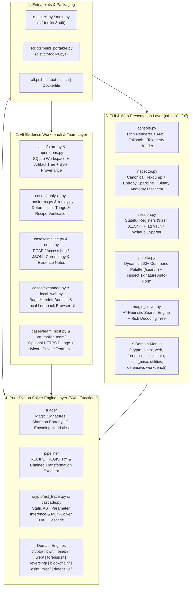

# CTF-Toolkit v5.0 — Architecture & Extension Guide

This document describes the internal architecture of `CTF-Toolkit v5.0`, how the **Headless Engine Layer**, **v5 Evidence Workbench (`ctf_toolkit/cases/`)**, **Private Team Host (`ctf_toolkit_team/`)**, and **TUI Presentation Layer** interact, and how to add new solver primitives or recipe operations.

---

## 1. Layered System Architecture

### Design Principles
1. **Strict Engine / UI Decoupling:** Core solver modules (`ctf_toolkit/crypto/`, `ctf_toolkit/pwn/`, `ctf_toolkit/forensics/`, etc.) are pure functions accepting `bytes`/`str`/`int` and returning structured data without calling `input()` or `print()`. This allows every primitive to be imported in standalone scripts, called from the `/search` Command Palette or `ctf-toolkit call`, or tested via synthetic twin benchmarks.
2. **Isolated Optional Team Host (`ctf_toolkit_team/`):** The v5 Evidence Workbench runs locally using standard library `sqlite3` and `http.server` (`ctf_toolkit/cases/`). The optional multi-user HTTPS server (`ctf_toolkit_team/`) is isolated as a separate top-level package loaded lazily by `ctf_toolkit/cases/team_host.py` when installed via `pip install -e ".[team]"`.
3. **Deterministic Byte-Level Provenance:** Every transformation in the v5 Case Workbench (`b64d`, `b64e`, `hex_decode`, `hex_encode`) records an exact byte-interval mapping back to its parent artifact so analysts can trace decoded bytes to their source offset and verify replays across machines (`verify --replay`).
4. **Graceful Degradation (`HAS_RICH`):** `ctf_toolkit/ui/console.py` detects whether `rich` is installed. If `rich` is available, it renders rounded panels, 2-column grids, and colorized tables. If running inside a minimal `.pyz` jumpbox without `rich`, it automatically falls back to clean standard output.
5. **Cross-Platform UTF-8 Safety:** `configure_utf8_console()` in `main_cli.py` reconfigures standard streams to UTF-8 with `errors="replace"` so Unicode box characters and sparklines never crash on legacy Windows codepages (`cp1252`).

---

## 2. Autonomous A* Magic Solver (`ctf_toolkit/ui/magic_solver.py`)

The Magic Solver models multi-layer decoding as a best-first graph search problem:
- **State Representation:** Each node in the priority queue is `(-score, depth, path, data_bytes)`.
- **Heuristic Fitness Function (`score_plaintext`):**
  - **Immediate Goal Detection (`+10,000`):** Matches standard CTF flag formats (`FLAG{...}`, `CTF{...}`, `GETSFLAG{...}`, `LKS{...}`, `picoCTF{...}`, `HTB{...}`, `THM{...}`, `dice{...}`, `ASIS{...}`, `SEKAI{...}`) plus Indonesian edition families whose prefix is a brand stem with an optional edition number (`COMPFEST<n>{...}`, `GEMASTIK<n>{...}`, `WRECKIT<n>{...}`, `HOLOGY<n>{...}`, `slashroot<n>{...}`, `ARKAV{...}`).
  - **Printable ASCII Density (`0..100`):** Rewards candidates where $\ge 70\%$ of bytes are printable ASCII (`0x20..0x7E` or whitespace).
  - **Index of Coincidence (`+50`):** Rewards letter distributions near natural language ($0.050 \le \text{IC} \le 0.085$).
  - **Entropy Window (`+30`):** Rewards Shannon entropy in the natural text band ($3.5 \le H \le 5.5\text{ bits/byte}$).
- **Dynamic Single-Byte XOR Expansion:** At each node, the solver sweeps all 255 single-byte XOR keys and queues the top 4 keys ranked by Base64 alphabet validity and printable ASCII ratio.

---

## 3. Static AST Tracer & Multi-Solver Cascade (`ctf_toolkit/crypto/ast_tracer.py` & `cascade.py`)

For script-based cryptography challenges (`chall.py` + `output.txt`):
1. **Static AST Inspection (`trace_file` / `trace_directory`):** Parses Python challenge scripts via `ast` without executing untrusted code, detecting prime generation calls (`getPrime`), RSA/Paillier/ECC/LFSR/AES patterns, exponent sizes, and variable assignments.
2. **Parameter Resolution (`infer_params`):** Correlates AST symbols with values printed in `output.txt` (`n`, `e`, `c`, `p`, `q`, `dp`, `dq`, `hint`, `iv`, `ct`).
3. **DAG Cascade Execution (`run_cascade`):** Schedules applicable mathematical solvers (`solve_rsa_auto`, `coppersmith`, `paillier`, `dlog`, `lfsr`, `block_attacks`, etc.) under a strict deadline and verifies candidate plaintexts against active flag templates.

---

## 4. Adding a New Solver Primitive

1. **Implement the Pure Function:** Add your solver function with full type annotations and a concise one-line docstring in the appropriate domain module (e.g. [`ctf_toolkit/crypto/rsa.py`](../ctf_toolkit/crypto/rsa.py)).
2. **Automatic Command Palette Indexing:** Public functions in `ENGINE_PACKAGES` with scalar parameters are automatically discovered and indexed by [`ctf_toolkit/ui/palette.py`](../ctf_toolkit/ui/palette.py). The Command Palette inspects parameter types via `inspect.signature` to build an interactive prompt form and expose the function via `ctf-toolkit call`.
3. **Register as a Recipe Step (Optional):** Decorate or register single-input transformations in `RECIPE_REGISTRY` inside [`ctf_toolkit/pipeline/recipe.py`](../ctf_toolkit/pipeline/recipe.py).
4. **Add a Synthetic Twin Test:** Add a deterministic unit test in `tests/` (or `qa/cases/` for Workbench features) and verify with `python run_tests.py`.
