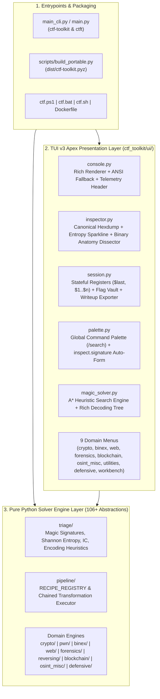

# CTF-Toolkit v3.0 Apex — Architecture & Extension Guide

This document describes the internal architecture of `CTF-Toolkit`, how the **Headless Engine Layer** separates from the **TUI v3 Presentation Layer**, and how to add new solver primitives or recipe operations.

---

## 1. Layered System Architecture

### Design Principles
1. **Strict Engine / UI Decoupling:** Core solver modules (`ctf_toolkit/crypto/`, `ctf_toolkit/pwn/`, `ctf_toolkit/forensics/`, etc.) are pure functions accepting `bytes`/`str`/`int` and returning structured data without calling `input()` or `print()`. This allows every primitive to be imported in standalone scripts, called from the `/search` Command Palette, or tested via synthetic twin benchmarks.
2. **Graceful Degradation (`HAS_RICH`):** `ctf_toolkit/ui/console.py` detects whether `rich` is installed. If `rich` is available, it renders rounded panels, 2-column grids, and colorized tables. If running inside a minimal `.pyz` jumpbox without `rich`, it automatically falls back to clean standard output.
3. **Cross-Platform UTF-8 Safety:** `configure_utf8_console()` in `main_cli.py` reconfigures standard streams to UTF-8 with `errors="replace"` so Unicode box characters and sparklines never crash on legacy Windows codepages (`cp1252`).

---

## 2. Autonomous A* Magic Solver (`ctf_toolkit/ui/magic_solver.py`)

The Magic Solver models multi-layer decoding as a best-first graph search problem:
- **State Representation:** Each node in the priority queue is `(-score, depth, path, data_bytes)`.
- **Heuristic Fitness Function (`score_plaintext`):**
  - **Immediate Goal Detection (`+10,000`):** Matches standard CTF flag formats (`FLAG{...}`, `CTF{...}`, `GETSFLAG{...}`, `LKS{...}`, `picoCTF{...}`).
  - **Printable ASCII Density (`0..100`):** Rewards candidates where $\ge 70\%$ of bytes are printable ASCII (`0x20..0x7E` or whitespace).
  - **Index of Coincidence (`+50`):** Rewards letter distributions near natural language ($0.050 \le \text{IC} \le 0.085$).
  - **Entropy Window (`+30`):** Rewards Shannon entropy in the natural text band ($3.5 \le H \le 5.5\text{ bits/byte}$).
- **Dynamic Single-Byte XOR Expansion:** At each node, the solver sweeps all 255 single-byte XOR keys and queues the top 4 keys ranked by Base64 alphabet validity and printable ASCII ratio.

---

## 3. Adding a New Solver Primitive

1. **Implement the Pure Function:** Add your solver function with full type annotations and a concise one-line docstring in the appropriate domain module (e.g. `ctf_toolkit/crypto/rsa.py`).
2. **Register in the Command Palette (Optional):** Add the function name to `CATALOG_SOURCES` in [`ctf_toolkit/ui/palette.py`](file:///C:/Users/Friel/Documents/Rifqi%20Ariansyah/CTF-Toolkit/ctf_toolkit/ui/palette.py). The Command Palette will automatically inspect its parameter types and build an interactive prompt form.
3. **Register as a Recipe Step (Optional):** Decorate or register single-input transformations in `RECIPE_REGISTRY` inside [`ctf_toolkit/pipeline/recipe.py`](file:///C:/Users/Friel/Documents/Rifqi%20Ariansyah/CTF-Toolkit/ctf_toolkit/pipeline/recipe.py).
4. **Add a Synthetic Twin Test:** Add a deterministic unit test in `tests/` and verify with `python run_tests.py`.
